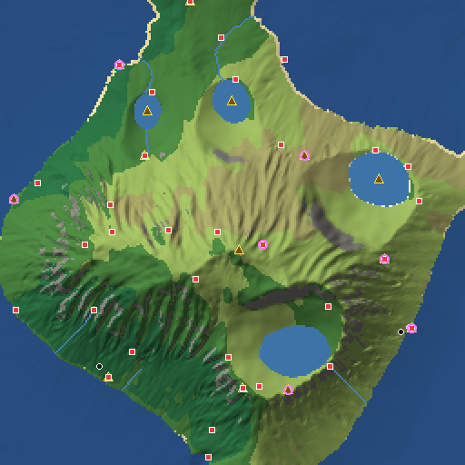
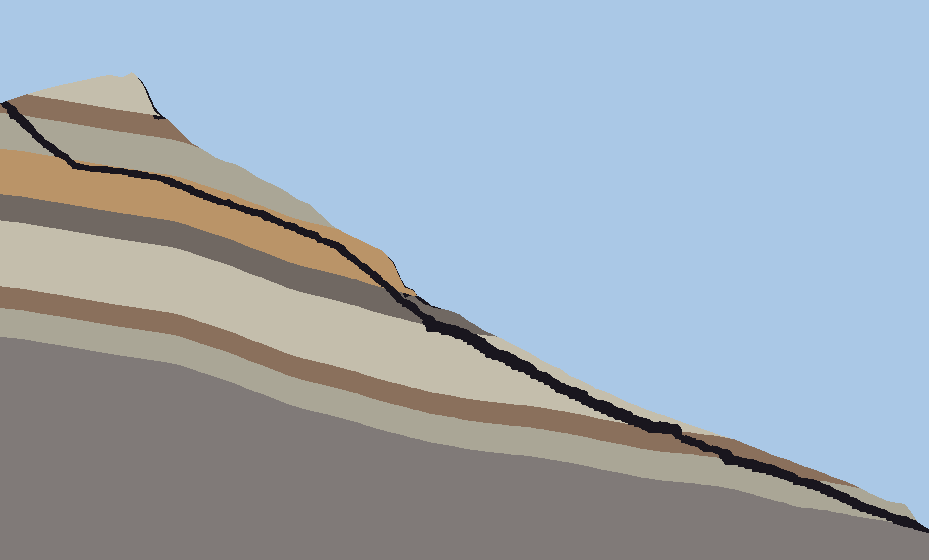
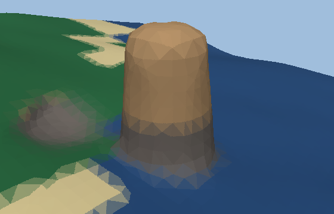
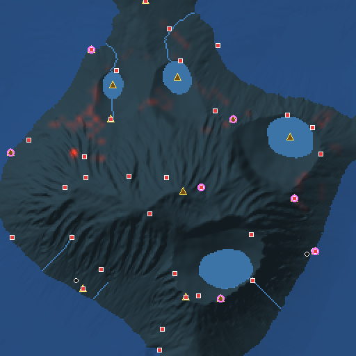

# OFM: 시뮬레이션 기반 오픈월드 맵 생성기

OFM은 물리 시뮬레이션과 환경심리학 시뮬레이션으로 오픈월드 지형을 만들고, 로컬 AI로 맵의 흥미도를 평가해 스스로 개선한 뒤 **Unity / Unreal 에디터에 외부에서 접속해** 월드를 구성하는 도구입니다.
동굴, 절벽 오버행, 해식 노치, 자연 아치, 호수, 하천, 바다를 자동으로 만듭니다. 단순한 높이맵을 넘어서기 위해 **희소 3D 밀도장(SDF) 레이어**를 함께 사용합니다.

```
판 구조 ─▶ 지층 ─▶ 수력·열 침식 ─▶ 분지 ─┐                 (물리)
                                          ▼
기후(수분 이류·비그늘) ─▶ 수문(호수 물수지·하천·폭포) ─▶ 바이옴
                                          ▼
카르스트 동굴 에이전트 · 절벽/해안 마스크 · 암석 랜드마크(SDF)    (3D)
                                          ▼
디테일 증폭(지층 단구) ─▶ POI·식생 분포
                                          ▼
가시권(isovist) · 조망-피신 · Kaplan 선호 · 랜드마크 · 탐험 에이전트  (심리)
                                          ▼
   ┌───── 로컬 AI 디렉터: 평가 → 화이트리스트 액션 → 재시뮬레이션 → 개선 시에만 채택 ─────┐
   └──────────────────────────────────────────────────────────────────────────────┘
                                          ▼
명칭·설정 생성 ─▶ 청크 단위 Surface Nets 메싱 + 터레인 구멍 ─▶ 내보내기 ─▶ Unity / Unreal
```

Python 3.11 이상이 필요하고, 의존성은 `numpy`, `Pillow` 두 개뿐입니다. 기본 프리셋(4.1 km × 4.1 km)은 AI 개선 3회를 포함해 약 1분 안에 생성됩니다.

| 지형·바이옴·POI | 동굴 단면(지층을 따라 진행하는 카르스트 통로) |
|---|---|
|  |  |
| **해식주(파식 노치 포함)** | **탐험 에이전트가 지루해한 경로** |
|  |  |

---

## 빠른 시작

```bash
pip install -e .            # 또는: pip install numpy pillow
python -m ofm generate --preset default --out out/demo
```

결과: `out/demo/world.json`(매니페스트), 터레인·메시·물·식생 파일, `previews/*.png`, `report.md`.

```bash
python -m ofm presets                                   # default, quick, alpine, archipelago, canyon
python -m ofm generate --preset alpine --seed 7         # 다른 지형 프리셋
python -m ofm generate --preset quick --set caves.density=2.5 --set world.shape=coast
python -m ofm generate --preset default --ai ollama --model qwen2.5:14b --iterations 4
python -m ofm generate --preset default --mesh-mode full     # 터레인 없이 전부 메시(Nanite용)
python -m ofm generate --preset default --push unity         # 생성 후 열려 있는 Unity로 바로 전송
```

---

## 1. 높이맵을 넘어서: 하이브리드 볼륨 구조

높이맵은 한 (x, y)에 높이 하나만 저장하므로 동굴, 오버행, 아치를 표현할 수 없습니다. OFM은 지형을 두 층으로 다룹니다.

1. **2.5D 지층 높이장**: 일반 지면입니다. 엔진의 네이티브 터레인(Unity Terrain, Unreal Landscape)으로 내보내므로 LOD, 페인팅, 식생 시스템을 그대로 쓸 수 있습니다.
2. **희소 3D 밀도장 D(x, y, z)**: 필요한 곳에서만 계산합니다(양수 = 암석, 음수 = 공기).
   - 높이장에서 근사 부호거리 `(h − z) / √(1 + |∇h|²)`로 시작합니다.
   - **차별 풍화 오버행**: 절벽면의 무른 지층(셰일, 이암)은 단단한 캡록보다 더 깊이 후퇴해 처마 같은 오버행과 선반이 생깁니다.
   - **파식 노치**: 해안 절벽의 해수면 높이에 파랑 침식 홈을 팝니다.
   - **카르스트 동굴**: 캡슐 통로(평평한 보행 바닥), 타원체 공동, 벽면 3D 노이즈로 구성됩니다.
   - **암석 랜드마크 SDF**: 첨탑(후두), 해식주, 자연 아치, 뷰트, 선돌.
3. **청크 메싱**: 128 m 기둥 청크마다 Naive Surface Nets로 메싱합니다. 각 격자 모서리를 정확히 하나의 청크만 소유하므로 청크 사이 이음새가 완전히 맞물립니다(테스트로 검증).
4. **하이브리드 결합**: 지표 근처에서 볼륨이 높이장과 달라지는 곳(동굴 입구, 오버행, 랜드마크)에만 **터레인 구멍**을 뚫고, 그 자리를 볼륨 메시로 채웁니다. 지하 동굴 벽은 터레인과 겹치지 않으므로 구멍 없이 그대로 유지됩니다.

`--mesh-mode full`을 쓰면 월드 전체를 메시로 내보냅니다(Unreal Nanite 정적 메시, 터레인 구멍이 없는 엔진용).

## 2. 물리 시뮬레이션

| 단계 | 모델 | 결과 |
|---|---|---|
| 판 구조 (`geology/tectonics.py`) | 왜곡된 보로노이 판 + 판별 속도. 경계의 상대속도로 수렴(조산대), 발산(열곡)을 판정 | 산맥 띠, 열곡, 대륙 형태(continent·coast·archipelago·inland) |
| 지층 (`geology/strata.py`) | 반복 퇴적 사이클 + 화강암 기반암. 융기에 따른 습곡, 경사, 굴곡 | 깊이별 암석의 경도·용해도 |
| 수력 침식 (`physics/erosion.py`) | 벡터화된 빗방울 입자(관성, 운반능력, 퇴적, 증발). 침식량 × (1 − 경도) | 계곡, 우곡, 선상지. 무른 암석이 먼저 깎임 |
| 열 침식 | 안식각 초과 사면 붕괴. 안식각이 경도에 비례(33°→72°) | 단단한 층은 절벽, 무른 층은 애추 사면 |
| 분지 | 그라벤·권곡·케틀형 닫힌 함몰지 | 호수 후보 |
| 기후 (`physics/climate.py`) | 위도 + 기온감률, 탁월풍을 따른 반라그랑주 수분 이류, 지형성 강수, 포화 응결 | 바람받이 습윤 사면, 비그늘 사막 |
| 수문 (`physics/hydrology.py`) | Priority-Flood(Barnes 2014) 배수, 유량 누적, 함몰지별 **유입량 vs 증발량 물수지** | 개방호, 내륙 염호, 플라야, 하천(폭 ∝ Q^0.5), 폭포(천이점) |
| 바이옴 (`physics/biome.py`) | Whittaker 다이어그램 + 경사·물·해안 규칙 | 17개 바이옴, 8개 지면 재질 스플랫 |

## 3. 3D 지형 요소

- **카르스트 동굴** (`volume/caves.py`): 용해 에이전트가 강수가 많은 노출 석회암의 싱크홀에서 출발합니다. 불포화대에서는 지면 경사보다 가파르게 하강하고, 지하수면에 닿으면 계곡 사면의 샘(두 번째 입구)을 향해 수평으로 이동합니다. 매 걸음 용해도가 높은 지층과 절리(3D 노이즈)를 선호하며, 최소 피복 두께를 지키고, 분기하거나 공동을 만듭니다. 그 결과 **관통 가능한 동굴**(입구 2개)이 많이 생깁니다. 해안 절벽에는 해식동굴이 생기고, 석회암이 없는 지형에서는 균열 동굴로 대체합니다.
- **절벽**: 기울기가 큰 연속된 면만 볼륨으로 처리합니다(작은 경사 픽셀은 제외).
- **랜드마크** (`volume/cliffs.py`): 해식주는 해안 절벽 앞 얕은 바다에, 후두와 뷰트는 건조하고 단단한 암석 지대에, 아치는 불용성 경암 사면에 놓입니다.
- **디테일 증폭** (`detail/amplify.py`): Catmull-Rom 업샘플링 후, 경암·급경사에는 날카로운 ridged 디테일을, 토양에는 완만한 기복을 더하고, 물가는 매끄럽게 유지합니다. 급사면은 **지층 경계를 따라 단구화**해, 단단한 층은 수직 절벽과 그 위의 평탄면(벤치)이 됩니다(그랜드캐니언식 계단 지형).

## 4. 심리 시뮬레이션 (`psych/`)

| 지표 | 근거 | 측정 방법 |
|---|---|---|
| 조망(Prospect) / 피신(Refuge) | Appleton의 조망-피신 이론 | 관찰자 격자에서 48방향 광선 isovist를 계산합니다. 시야 면적과 시야 깊이로 조망을, 가까운 고각 수평선·수관·동굴 근접도로 피신을 측정합니다 |
| 미스터리 | Kaplan & Kaplan 선호 행렬 | 40–600 m에서 시야가 가려졌다가 더 멀리서 지면이 다시 보이는 방향의 비율("굽은 전망") |
| 복잡성 / 일관성 | Kaplan | 지역 바이옴 엔트로피·기복·특징 밀도 / 우세 피복 비율·미세 거칠기 |
| 가독성 | Lynch, *The Image of the City* | 랜드마크 후보(정상, 암석 지형, 폭포, 호수)의 가시선(LOS) 기반 현저성. 위치마다 보이는 랜드마크 수 |
| 페이싱 / 탐험 | 플레이테스트 에이전트 | 아래 참고 |

**호기심 기반 탐험 에이전트**(`psych/agents.py`): 탐험가·성취가·방랑자·관광객 성향의 에이전트들이 **토블러 보행 함수**(오르막에서 감속, 절벽·깊은 물 통과 불가, 동굴은 입구 사이 지름길)로 이동합니다. 인지 지도(본 것, 방문한 것)를 유지하며 *효용 / 이동시간*이 가장 큰 목표(발견한 POI, 랜드마크, 미탐색 경계)를 고릅니다. 이동 중에는 경험 이벤트(새 랜드마크, POI 발견·도착, 새 바이옴, 전망, 물)를 기록합니다. **75초 이상 이벤트가 없는 구간은 지루함**으로 보고, 그 시간과 위치를 지루함 지도에 쌓습니다. AI 디렉터가 "어디를 고칠지" 정하는 핵심 신호가 이 지도입니다.

종합 점수(0–10)는 경관 선호, 다양성, 가독성, 미스터리, 페이싱, 탐험, 조망-피신의 가중합입니다.

## 5. 로컬 AI 연동 (`ai/`)

- **서버**: Ollama(`/api/chat`) 또는 OpenAI 호환 서버(LM Studio, llama.cpp server, vLLM, LocalAI 등의 `/v1/chat/completions`)를 사용합니다. `provider = "auto"`이면 Ollama(11434), LM Studio(1234), llama.cpp(8080), 8000번 포트를 순서대로 탐색합니다. 표준 라이브러리만 쓰며, 시스템 프록시는 기본적으로 우회합니다.
- **평가**: 시뮬레이션 리포트(점수, 에이전트별 지루함, 4×4 지역표 A1–D4, 랜드마크, 동굴, 호수)를 레벨 디자이너 역할의 프롬프트로 보냅니다. 모델은 JSON으로 점수, 비평, 액션 목록을 반환합니다. 비전 모델을 쓸 때(`ai.vision = true`)는 미리보기 지도 이미지도 함께 보냅니다.
- **안전한 액션 어휘**: 모델은 코드나 지오메트리를 직접 쓰지 않습니다. `add_landmark`, `add_cave`, `add_lake`, `add_poi`, `raise_relief`, `smooth_terrain`, `set_param`(화이트리스트 파라미터만, 범위 제한) 중에서 고르고, 실제 위치는 시뮬레이션이 정합니다. 예를 들어 망루는 그 지역에서 조망이 가장 좋은 곳에, 야영지는 조망-피신이 가장 좋은 곳에 놓입니다.
- **디렉터 루프**: 액션을 적용한 사본에서 하류 시뮬레이션을 모두 다시 돌린 뒤, 목적함수(시뮬레이션 점수 70% + LLM 점수 30%, 설정 가능)가 **올라갈 때만 채택**합니다. 거절된 액션은 다음 프롬프트에 전달해 반복 제안을 막습니다.
- **디테일(명칭·설정)**: 지역, 랜드마크, POI, 동굴, 호수, 하천의 이름과 한 줄 설명을 생성합니다(`ai.language = "ko"`). AI가 없으면 한글 음절 조합기로 이름을 만듭니다(예: "미고 야영지", "보희 굴").
- **AI가 없을 때**: 같은 지표로 동작하는 결정론적 휴리스틱 리뷰어가 대신 작동하므로 파이프라인은 항상 끝까지 실행됩니다.

```bash
ollama pull llama3.1:8b          # 또는 qwen2.5:14b, llama3.2-vision(비전 평가) 등
python -m ofm ai-status          # 연결 확인
python -m ofm generate --preset default --ai ollama --model llama3.1:8b --iterations 4
```

## 6. Unity 연동

```bash
python -m ofm install unity /path/to/UnityProject     # Assets/OFM/{Editor,Runtime,Shaders} 복사
```

- **메뉴**: `Tools > OFM > Import World...`에서 `world.json`을 선택합니다.
- **외부 접속(브리지)**: 에디터가 열리면 `OFMBridgeServer`가 `127.0.0.1:8765`에서 대기합니다(`Tools > OFM > Bridge`). Python에서 바로 보낼 수 있습니다.
  ```bash
  python -m ofm push unity out/demo/world.json
  python -m ofm generate --preset default --push unity
  ```
  프로토콜은 줄 단위 JSON(`ping`, `import`, `clear`, `save`, `frame`)이며, 명령은 메인 스레드에서 실행됩니다.
- **배치 모드**: `python -m ofm batch unity out/demo/world.json --editor <Unity 실행파일> --project <프로젝트>`
- **생성되는 것**: Terrain(16비트 높이, 구멍, 8개 TerrainLayer 스플랫), 볼륨 메시(MeshCollider 포함), 호수·하천·바다, POI·랜드마크·동굴 입구 마커(`OFMMarker`), 식생입니다. `Assets > Create > OFM > Scatter Settings`에 프리팹을 매핑하면 Terrain 트리로 배치하고, 매핑이 없으면 플레이스홀더를 놓습니다.
- **렌더 파이프라인**: Built-in에서는 `OFM/VertexColorLit`(지층 색, 노출도 AO)를 사용합니다. URP/HDRP에서는 파이프라인 기본 Lit 재질로 대체되므로, 지층 색을 보려면 Shader Graph에서 *Vertex Color → Base Color*, *Vertex Color.A → Ambient Occlusion*으로 연결하세요.

## 7. Unreal 연동

1. 플러그인을 활성화합니다: **Python Editor Script Plugin**, **Remote Control API**(원격 전송 시), glTF 임포트(UE5 Interchange 기본 지원).
2. `python -m ofm install unreal /path/to/MyGame`을 실행하면 `Content/Python/ofm_unreal_import.py`가 복사됩니다.
3. 가져오는 방법은 세 가지입니다.
   - **원격**: `python -m ofm push unreal out/demo/world.json`. Remote Control API(30010)로 `PythonScriptLibrary.ExecutePythonCommand`를 호출합니다.
   - **에디터 콘솔**: `import ofm_unreal_import as o; o.import_world(r"C:/.../world.json")`
   - **헤드리스**: `python -m ofm batch unreal world.json --editor UnrealEditor-Cmd --project MyGame.uproject`
4. 볼륨 청크, 물, 마커를 `OFM/...` 아웃라이너 폴더에 배치합니다. `hybrid` 모드에서는 매니페스트의 `unreal_landscape`(16비트 PNG, 권장 해상도, 위치, 스케일, 레이어별 웨이트맵)로 Landscape를 가져오고(스크립트가 정확한 값을 로그로 출력), 터레인 구멍은 `terrain/holes.png`를 가시성 레이어로 칠합니다. `full` 모드는 Landscape 없이 메시만으로 구성되며 Nanite에 적합합니다.

## 8. 출력 포맷

| 파일 | 내용 |
|---|---|
| `world.json` | 매니페스트(Unity `JsonUtility` 호환). 좌표계, 모든 자산 경로, POI·랜드마크·동굴(Unity/Unreal 좌표 포함), 평가, 디렉터 이력, 설정 |
| `terrain/heightmap.r16` | Unity RAW 16비트 LE, 남→북 행 순서, 해상도 2ⁿ+1 |
| `terrain/heightmap_ue.png` | Unreal Landscape 16비트 PNG(32768 = 중앙 높이), 북→남 |
| `terrain/holes.r8`, `holes.png` | 터레인 구멍(1 = 구멍) |
| `terrain/splat.raw`, `splat_*.png`, `ue_layer_*.png` | 지면 재질 8종 가중치 |
| `meshes/*.glb` / `*.ofmmesh` | 볼륨 청크. glTF 2.0(정점색 포함) / Unity용 원시 바이너리(Unity 축·와인딩으로 변환 완료) |
| `water/*.glb` / `*.ofmmesh` | 호수 수면, 하천 리본(UV.y가 하류 방향) |
| `scatter/*.bin` | float32 `[x, y, z, yaw°, scale]` 인스턴스 |
| `previews/*.png` | 바이옴, 흥미도, 지루함, 높이 지도, 동굴 단면, 3D 썸네일 |
| `report.md`, `report.json` | 점수, 지표, AI 비평, 개선 이력 |

**좌표계**(`ofm/export/coords.py`): OFM은 미터 단위 오른손 좌표계(x 동, y 북, z 위)입니다. Unity는 `(x, z, y)`(와인딩 반전), glTF는 `(x, z, −y)`, Unreal은 `(100x, −100y, 100z)` cm입니다.

## 9. 설정

모든 파라미터는 `ofm/config.py`의 데이터클래스에 있고, TOML 파일이나 `--set 경로=값`으로 바꿀 수 있습니다. 프리셋은 다음과 같습니다.

| 프리셋 | 성격 |
|---|---|
| `default` | 온대 대륙 섬. 호수, 카르스트, 해식주 |
| `quick` | 2 km, 몇 초 만에 생성되는 실험용 |
| `alpine` | 고위도 내륙 고산. 빙하, 두꺼운 석회암, 많은 동굴 |
| `archipelago` | 열대 군도. 해식절벽·해식동굴, 바람받이와 비그늘 대비 |
| `canyon` | 건조 고원. 경암 캡록 + 무른 셰일 → 메사, 뷰트, 후두, 계단식 협곡 |

## 10. 개발

```bash
pip install -e ".[dev]"
python -m pytest -q
```

테스트는 노이즈와 그리드 연산, 메싱 수밀성과 청크 이음새, 물리 일관성(하천이 오르막으로 흐르지 않음, 호수 수면, 기온감률), 동굴 피복, 밀도장, 심리 지표 범위, 내보내기 왕복(높이맵, .ofmmesh, .glb), 모의 Ollama·OpenAI 서버를 통한 AI 리뷰, 디렉터의 단조 개선, 모의 Unity TCP·Unreal Remote Control 브리지, 가짜 `unreal` 모듈로 돌리는 Unreal 임포터를 다룹니다. Unity C# 스크립트는 API 스텁에 대해 `mcs`로 컴파일하고, `.ofmmesh` 리더가 Python 출력과 같은 값을 읽는지 mono로 확인했습니다.

## 한계와 다음 단계

- 엔진 스크립트는 실제 Unity/Unreal 에디터가 아니라 스텁·모의 환경에서 검증했습니다. Unreal의 glTF 임포터 축 변환은 UE5 기본값(`(X, Z, Y)` + m→cm)을 가정했습니다. 버전에 따라 다르면 `ofm/export/coords.py`와 `ofm_unreal_import.to_unreal`만 맞추면 됩니다.
- Naive Surface Nets는 얇은 지형에서 드물게 비다양체(non-manifold) 정점을 만들 수 있습니다(렌더링에는 영향 없음). 필요하면 Dual Contouring으로 교체할 수 있게 메셔를 분리해 두었습니다.
- 성능: 기본 4 km 월드는 약 1분이 걸립니다(numpy만 사용). 8 km 이상이면 `volume.voxel_size`, `psych.grid`, `erosion.droplets_per_cell`을 조정하세요.
